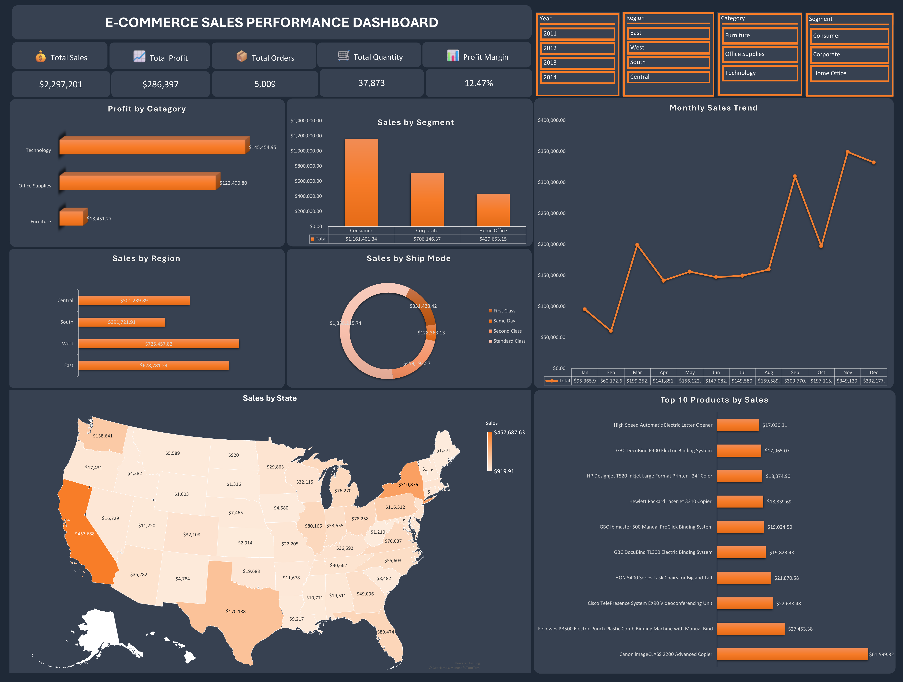

# 📊 E-Commerce Sales Performance Dashboard (Excel)

## 📌 Project Overview
This interactive Microsoft Excel dashboard analyzes **9,994 retail sales records** (2011–2014) from the US Superstore dataset to uncover revenue drivers, seasonal trends, and profit margin leakage.

### 🎯 Business Problem
Despite generating **$2.30M in total sales**, the business operates at a **12.47% profit margin** ($286.40K total profit). Leadership needed visibility into which product categories, regions, and months drive profitability—and where heavy discounting erodes margins.

---

## 🛠️ Tools & Methodology
* **Data Cleaning & Structuring:** Standardized date fields (`MONTH`, `YEAR2`) and validated 9,994 transaction rows across 26 fields.
* **Feature Engineering:** Created a helper column (`Order Count`) to accurately deduplicate line items and count **5,009 unique orders**.
* **Data Modeling & Visualization:** Built **14 Pivot Tables**, **7 dynamic charts**, KPI summary cards, and **4 interactive slicers** (Year, Region, Category, Segment).

---

## 📈 Key Performance Metrics

| Metric | Value |
| :--- | :--- |
| **Total Sales** | $2,297,200.86 |
| **Total Profit** | $286,397.02 |
| **Profit Margin** | 12.47% |
| **Unique Orders** | 5,009 |
| **Total Line Items** | 9,994 |
| **Total Quantity Sold** | 37,873 units |
| **Average Discount** | 15.62% |

---

## 💡 Key Insights
* **Category Profitability:** **Technology** ($836.15K sales, $145.45K profit) and **Office Supplies** ($719.05K sales, $122.49K profit) generated over 93% of total profit. **Furniture** generated $742.00K in sales but only **$18.45K in profit** (~2.5% margin) due to heavy discounting on Tables and Bookcases.
* **Regional Performance:** The **West** led all regions with **$725.46K** in sales (led by California at $457.69K), while the **South** trailed at **$391.72K**.
* **Customer Segments:** **Consumer** accounted for 50.6% of total revenue ($1.16M), followed by **Corporate** ($706.15K) and **Home Office** ($429.65K).
* **Seasonality:** Sales surged consistently in Q4, peaking in **November ($349.12K)**, **December ($332.18K)**, and **September ($309.77K)**.

---

## 🚀 Business Recommendations
1. **Audit Furniture Discounting:** Cap discounts on low-margin sub-categories like Tables and Bookcases to stop profit leakage.
2. **Prepare for Q4 Demand Surges:** Align inventory procurement and marketing spend ahead of the September–December peak window.
3. **Replicate West Region Playbook:** Analyze top-performing product bundles and shipping modes in the West to pilot growth initiatives in the South.

---

## 📂 Repository Structure
* `Ecommerce_Sales_Performance_Dashboard.xlsx` — Full interactive Excel workbook with raw data, Pivot Tables, and dashboard.
* `dashboard_preview.png` — High-resolution dashboard preview.
